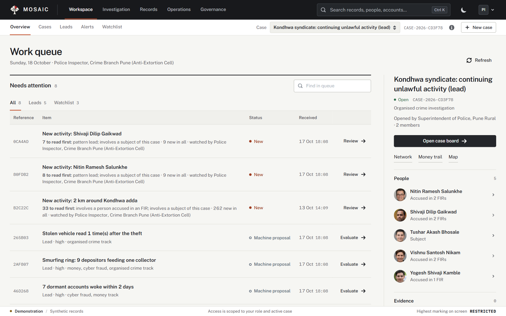
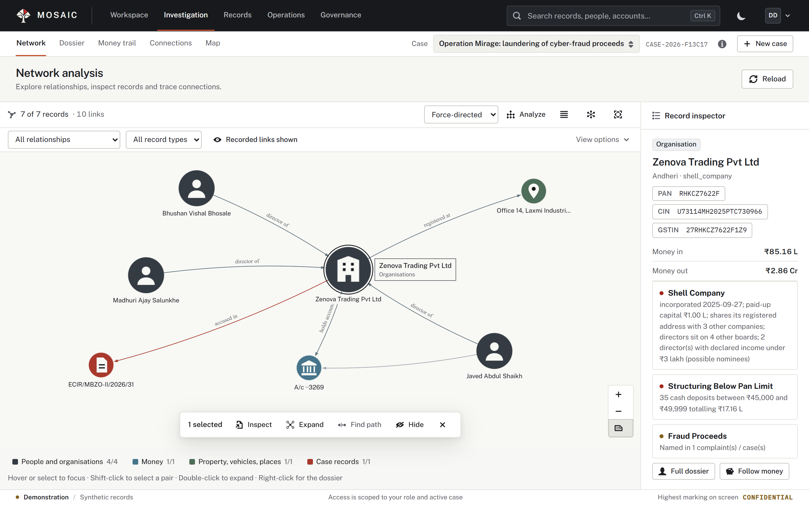
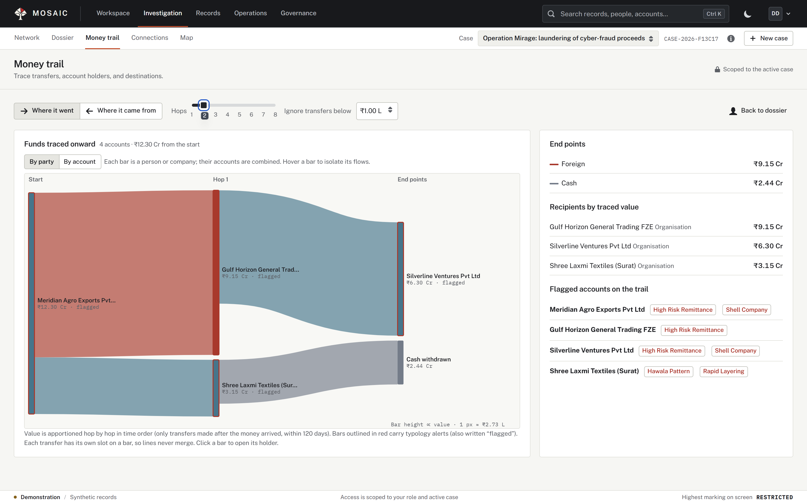
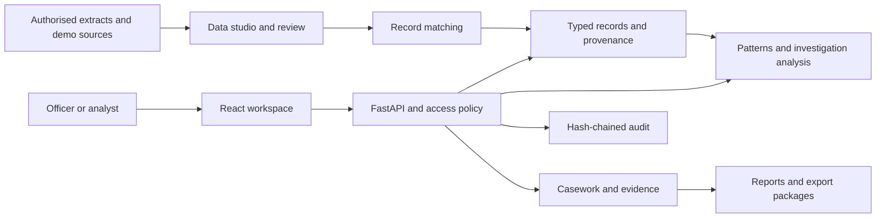

<picture>
  <source media="(prefers-color-scheme: dark)" srcset="brand/weirwood-logo-light-512.png">
  
</picture>

# Mosaic by Weirwood

**An investigation and intelligence workspace for Indian public institutions.**

Mosaic connects an agency’s authorised records into a shared picture of people, organisations, money, phones, places, and events. Investigators can follow a finding from its source through a dossier, network, case decision, evidence locker, and report. Access is governed by role, agency, case, purpose, and clearance.

[Get started](#get-started) | [Documentation](docs/README.md) | [Product brochure](docs/Mosaic-Brochure.pdf) | [Screenshots](docs/screenshots.md) | [Contributing](CONTRIBUTING.md)



*The investigation workspace, captured from the synthetic demonstration. People, accounts, companies, and cases shown in product screenshots are fictional; geographic reference data and public disaster alerts may describe real places.*

## What Mosaic brings together

An investigation often starts with a name, phone number, account, vehicle, or case reference. The supporting records arrive from different systems, in different formats and scripts. Mosaic connects those records while keeping the source, uncertainty, and access context visible.

| Workflow | What the application provides |
| --- | --- |
| **Connect and prepare** | Data studio for profiling, cleaning, field mapping, matching, review, and approval of incoming records. |
| **Resolve identities** | Cross-script name normalisation, phonetic matching, probabilistic record linkage, explanations, and a review queue. |
| **Investigate** | Entity dossiers, interactive networks, connection paths, money trails, timelines, maps, and area searches. |
| **Review leads** | 19 pattern detectors, financial typologies, agency mission tracks, alerts, and case watchlists. |
| **Manage the case** | Case boards, recorded reasons, supervisor approvals, evidence custody, reports, and export packages. |
| **Account for access** | Purpose and case checks, clearance masking, two-person workflows, a hash-chained audit trail, and oversight views. |

The interface contains 17 workspaces, organised into **Workspace**, **Investigation**, **Records**, **Operations**, and **Governance**. The [48-page brochure](docs/Mosaic-Brochure.pdf) introduces the product; the [120-page product book](docs/Mosaic-Product-Book.pdf) documents the individual screens.

## Product status

This repository contains a working development and demonstration implementation. Its Python distribution is currently version `0.1.0`. The user-facing product is **Mosaic**, by **Weirwood**; the Python package, command-line executable, API headers, and environment variables retain the internal name **`drishti`**.

The demonstration combines synthetic investigative records with attributed public reference data. It does not establish a live connection to restricted government systems. Agency names describe modelled roles and workflows, not endorsements or deployments.

The software proposes matches and leads for review. Case-specific rankings and face-similarity candidates are analytical aids, not identity determinations or findings of guilt. Historical benchmark and security reports are available in [docs/research](docs/research/README.md); they are dated engineering records, not independent certification or production-performance guarantees.

## Get started

Use **Python 3.11 or newer** and **Node.js 22.12 or newer in the Node 22 line**, with npm. Python 3.12 and Node 22 are the recommended development baseline. Git is required to clone the repository.

```bash
git clone https://github.com/omkar-sarswat/mosaic.git
cd mosaic
python -m venv .venv
```

Activate the environment for your shell:

```powershell
# Windows PowerShell
.\.venv\Scripts\Activate.ps1
```

```bash
# macOS or Linux
source .venv/bin/activate
```

Install the backend, build the interface, and start the demonstration:

```bash
python -m pip install -e .
cd web
npm ci
npm run build
cd ..
drishti demo --no-portraits --no-redteam
```

Open **[http://127.0.0.1:8000](http://127.0.0.1:8000)**. The first run builds a SQLite database at `var/drishti.db`; subsequent runs reuse it. The command above skips optional portrait assignment and the adversary simulation to keep the first run focused on the workspace. Generation time depends on the machine.

No cloud API key is required for this local demonstration. Package installation needs network access. Map tiles and explicitly requested live feeds also use the network; a completely disconnected deployment needs local equivalents.

The [getting-started guide](docs/getting-started.md) covers the first investigation, optional face-search setup, development servers, and common startup problems.

### A first walkthrough

1. Open the account menu and select a synthetic demonstration role, such as **Police Inspector, Crime Branch Pune**.
2. Select an available case. Its purpose and legal basis remain visible in the workspace.
3. Use **Ctrl+K** to search for a name, number, or identifier. Open a result to inspect its dossier and sources.
4. Open **Network**, **Money trail**, or **Connections** to explore the same case records from another perspective.
5. Use **Cases** to inspect the board, approvals, evidence, and reports. Switch to the appropriate supervisor role to explore a second-officer workflow.
6. Select the oversight role to inspect access records and audit verification separately from case investigation.

## Inside the workspace

### Networks and money trails



The network connects people, organisations, accounts, phones, places, and source records. A selected entity opens its context in the inspector. Recorded and machine-proposed relationships have distinct presentations.



Money trail follows funds outward or back to source, by party or account, with amounts and destinations linked to their underlying records. See the [screenshot gallery](docs/screenshots.md) for casework, data intake, evidence, and oversight.

### Roles and workflows

| Role | Primary work |
| --- | --- |
| Investigating officer | Search records, follow connections, manage the case, attach evidence, and request actions. |
| Supervisor | Review requests, approve permitted actions, and provide the second officer in protected workflows. |
| Analyst | Examine networks, money trails, patterns, and cross-record evidence within authorised scope. |
| Data steward | Prepare source extracts, inspect quality, map fields, and review proposed matches. |
| Oversight officer | Review access events, audit integrity, and insider-threat alerts. |
| Disaster control-room operator | Inspect public alerts, affected districts, hospitals, and relief dispatches. |

The model includes state police and cyber cells, NIA, NCB, CBI, ED, IB, R&AW, and disaster-management roles. Access depends on the configured agency, purpose, role, case membership, and clearance.

## How it works



| Layer | Implementation |
| --- | --- |
| Interface | React 19, TypeScript, Vite, Blueprint, and Mantine. |
| Networks and charts | Graphology, Sigma, and ECharts. |
| Maps | MapLibre GL JS with public reference layers. |
| API and workflows | Python, FastAPI, and Uvicorn. |
| Storage | SQLite by default; a PostgreSQL adapter is available. |
| Identity and policy | Local demonstration identities; optional Keycloak OIDC and Open Policy Agent. |
| Matching | Indic-script normalisation, phonetic comparison, and Fellegi–Sunter record linkage. |
| Optional face comparison | OpenCV with YuNet and SFace model files, installed separately. |

See [architecture](docs/architecture.md) for module boundaries and [deployment](docs/deployment.md) for configuration and operational limits.

## Repository map

```text
brand/                  Official Weirwood logo variants and icons
data/reference/         Attributed geography, LGD codes, and hospital data
data/samples/           Saved alerts and synthetic demonstration images
deploy/                 Container build, Compose stack, and Keycloak realm
docs/                   Guides, research, product publications, and screenshots
drishti/                Python application and command-line interface
  api/                  HTTP routes and request dependencies
  analytics/            Networks, financial analysis, and inference
  connectors/           LGD, SACHET, and OSM adapters
  guard/                Identity, policy, masking, and audit
  intake/               Source preparation and publication workflows
  patterns/             Detectors, evaluation, and adversary simulation
  resolve/              Name processing and record matching
  synth/                Reproducible synthetic investigation scenarios
  vision/               Case-bound image and face-comparison workflows
models/                 Record-matcher parameters
ontology/               Record types, links, actions, and purposes
policies/               Rego policy for Open Policy Agent
scripts/                Data preparation and browser-check utilities
web/                    React application
```

Downloaded benchmark datasets, model binaries, local databases, credentials, environments, and build output are excluded from Git. Product publications, source code, official brand assets, attributed reference data, and demonstration screenshots are included. See [repository assets](docs/repository-assets.md) for the exact distinction.

## Development and validation

```bash
# Frontend, from web/
npm ci
npm run build
npm run lint

# Backend, from the repository root with the virtual environment active
python -m compileall -q drishti
python -c "from drishti.api.app import app; print(app.title)"
drishti --help
```

These commands check the build, lint rules, Python syntax, and application imports. This snapshot does **not** contain the `tests/` or `bench/` directories referenced by some historical research reports. Do not interpret those reports as a test suite shipped with this repository. Browser-check scripts are present in `scripts/` and need a running synthetic demo and Playwright.

The repository’s CI workflow checks Python imports and the frontend production build. Contribution and review expectations are in [CONTRIBUTING.md](CONTRIBUTING.md); the [development guide](docs/development.md) explains local verification and the current coverage gaps.

## Documentation

| Document | Audience and purpose |
| --- | --- |
| [Documentation index](docs/README.md) | Entry point for product, engineering, and research material. |
| [Product brochure](docs/Mosaic-Brochure.pdf) | 48-page introduction to Weirwood, Mosaic, and its capabilities. |
| [Product guide](docs/Mosaic-Product-Guide.pdf) | 30-page narrative walkthrough of the product. |
| [Product book](docs/Mosaic-Product-Book.pdf) | 120-page reference with 88 original screenshot figures. |
| [Getting started](docs/getting-started.md) | Install, run, and explore the demonstration. |
| [Architecture](docs/architecture.md) | Runtime, storage, module responsibilities, and access flow. |
| [Development](docs/development.md) | Commands, local checks, and contribution workflow. |
| [Deployment](docs/deployment.md) | Configuration, containers, identity, and database options. |
| [Research pack](docs/research/README.md) | Design rationale, historical measurements, and assessment notes. |

## About Weirwood

Weirwood builds investigation and intelligence software for Indian institutions. Mosaic’s product direction centres on connected records, visible evidence, human decisions, and accountable access. The official tree mark is formed from six tiles; the red tile represents the piece of information that completes the picture. The [brochure](docs/Mosaic-Brochure.pdf) explains the company and product identity.

For reproducible bugs or feature proposals, use the repository’s [issue tracker](https://github.com/omkar-sarswat/mosaic/issues). Include the relevant workspace, steps, expected result, and a minimal synthetic example.

## License and attribution

The application is licensed under the **[Apache License 2.0](LICENSE)**. Public reference data, fonts, and other third-party assets retain their own terms; see [NOTICE](NOTICE), the [asset inventory](docs/repository-assets.md), and the notices bundled with those assets. The original DRISHTI contributor notices are preserved.
