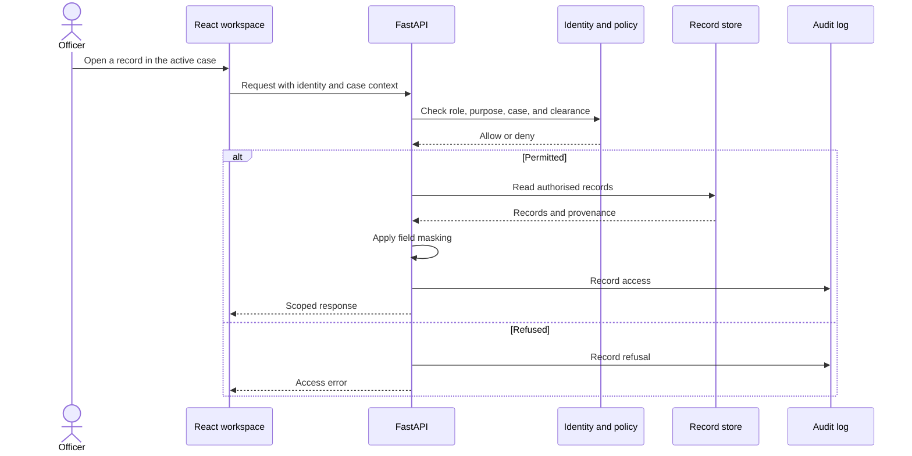

# Architecture

Mosaic is a React client served by a Python FastAPI application. The default storage is a local SQLite database. The same source includes a PostgreSQL compatibility layer and integrations for Keycloak identity and Open Policy Agent decisions.

## Request and data flow

This is a conceptual request flow. Individual routes live in `drishti/api/`; policy and audit behaviour must be inspected there when changing access rules.

## Module responsibilities

| Location | Responsibility |
| --- | --- |
| [`web/src/App.tsx`](../web/src/App.tsx) | Navigation groups, workspace selection, account context, and lazy-loaded views. |
| [`web/src/api.ts`](../web/src/api.ts) | Client requests and identity/case headers. |
| [`drishti/api/`](../drishti/api/) | Search, dossiers, analysis, cases, intake, evidence, faces, and oversight routes. |
| [`drishti/config.py`](../drishti/config.py) | Paths, database selection, identity mode, policy service, and matcher settings. |
| [`drishti/store.py`](../drishti/store.py) | Typed records, relationships, provenance, search, and persistence. |
| [`drishti/db.py`](../drishti/db.py), [`drishti/pgcompat.py`](../drishti/pgcompat.py) | Database selection and PostgreSQL adaptation. |
| [`ontology/core.yaml`](../ontology/core.yaml) | Record definitions, link types, actions, masking, and approved purposes. |
| [`drishti/guard/`](../drishti/guard/) | Identity, case policy, masking, and the audit chain. |
| [`policies/drishti.rego`](../policies/drishti.rego) | OPA version of the access policy. |
| [`drishti/resolve/`](../drishti/resolve/) | Script handling, name comparison, probabilistic matching, and review decisions. |
| [`drishti/intake/`](../drishti/intake/) | Source profiling, transformations, proposals, and controlled publication. |
| [`drishti/analytics/`](../drishti/analytics/) | Network structure, money tracing, typologies, and inferred relationships. |
| [`drishti/patterns/`](../drishti/patterns/) | Detector catalogue, leads, evaluation, and adversary simulation. |
| [`drishti/evidence.py`](../drishti/evidence.py), [`drishti/casereport.py`](../drishti/casereport.py) | Evidence custody, export packages, and case reports. |
| [`drishti/vision/`](../drishti/vision/) | Image handling, gallery records, and optional face comparison. |
| [`drishti/pipeline.py`](../drishti/pipeline.py), [`drishti/synth/`](../drishti/synth/) | Synthetic world construction and demonstration cases. |

## Runtime boundaries

- **Identity:** development mode uses known synthetic accounts. OIDC mode verifies bearer tokens from the configured provider. The browser includes an OIDC flow in `web/src/`.
- **Access:** the active case supplies purpose and scope. Record and field access are evaluated separately from whether a navigation item is visible.
- **Evidence:** content hashes and custody records support traceability. The export includes a draft certificate; human verification and signing remain part of the workflow.
- **Analysis:** recorded relationships and inferred relationships remain distinguishable. A detector result is a reviewable lead with supporting records.
- **Storage:** SQLite supports a local demonstration. PostgreSQL support does not by itself establish throughput, availability, or disaster-recovery guarantees.
- **Offline behaviour:** local application assets and records can operate without hosted services once prepared. Map tiles, live feeds, model downloads, and a remote identity provider require corresponding connectivity or local hosting.

## Compatibility naming

The product was developed under the internal name DRISHTI. This repository uses Mosaic branding while retaining `drishti`, `DRISHTI_*`, and `X-DRISHTI-*` identifiers. Renaming these interfaces would be a separate migration involving installations, environment configuration, stored state, and client integrations.

## Evidence and open questions

The [research pack](research/README.md) records earlier implementation decisions and experiments. The [security review](research/11-security-review.md) describes its assessment scope and exclusions. Neither replaces current testing or an independent deployment assessment. Earlier references to test and benchmark directories describe material not included in this source snapshot.
