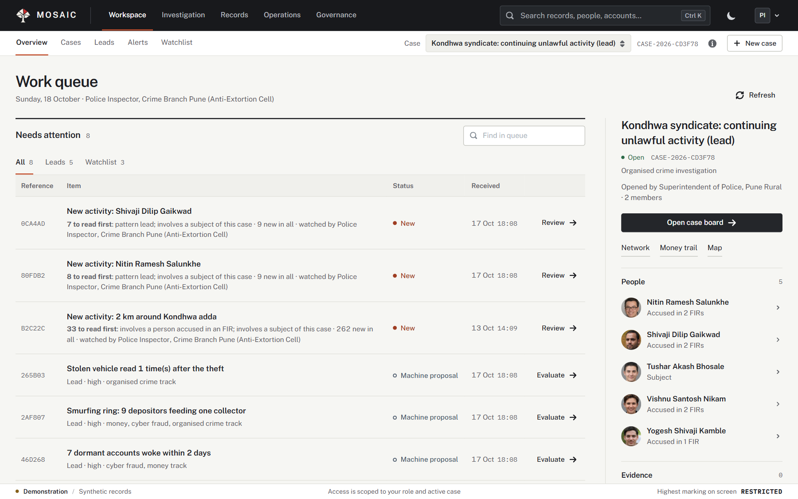
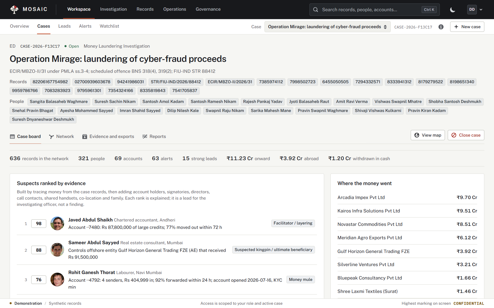
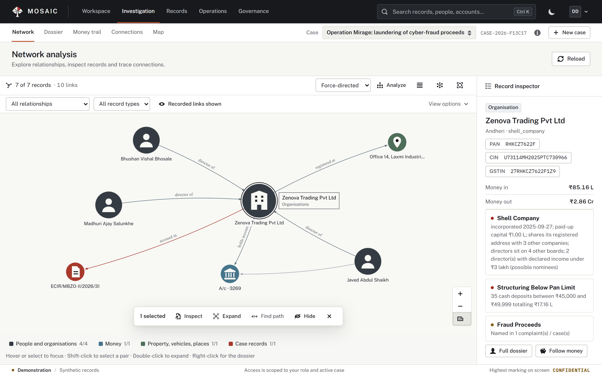
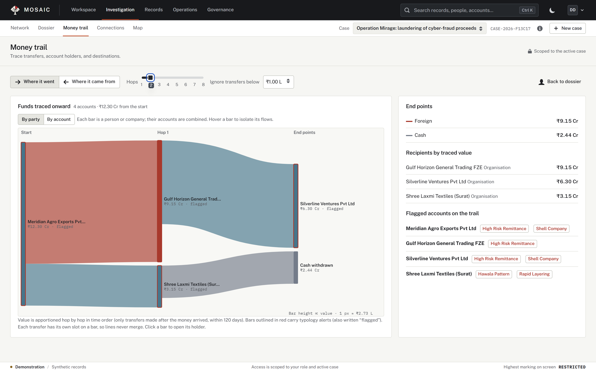
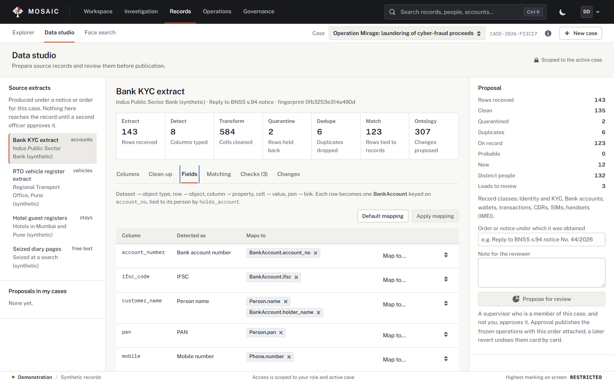
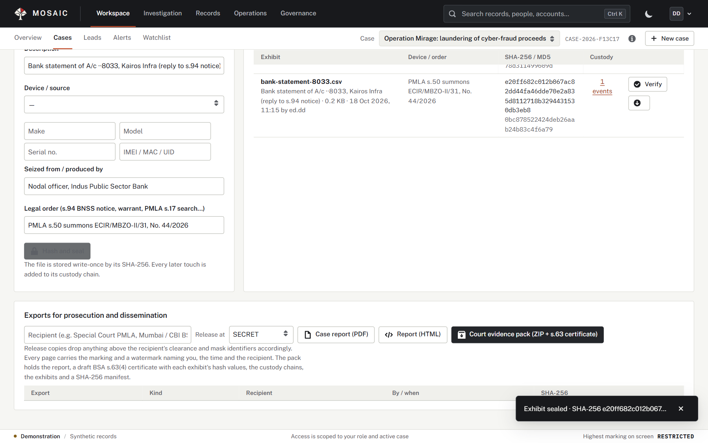
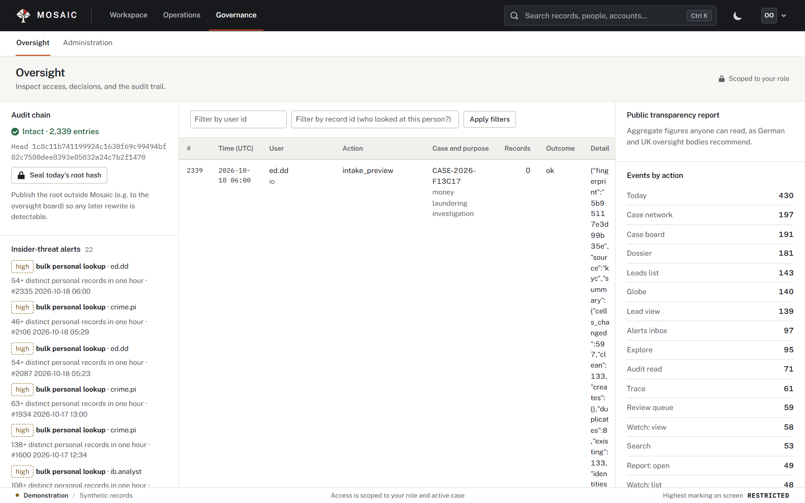

# Mosaic in use

These are original application captures from the October 2026 product-book collection. They show synthetic investigative records and demonstration roles. The full images are retained, with no cropping or invented interface elements. Click an image to inspect it at its original size.

## Work queue

The officer starts with pending leads, watch updates, and the active case. The case context stays beside the work queue.

## Case board

Case records, reviewable findings, and investigation progress are assembled in a shared workspace.

## Network

The investigator follows relationships and inspects their records. A selected entity remains connected to its surrounding case context.

## Money trail

Transfers can be followed through parties or accounts, with traced destinations and supporting records.

## Data studio

Incoming fields are inspected and mapped before publication. Preparation and approval remain visible steps in the workflow.

## Evidence and exports

Exhibits stay attached to a case with their hashes and custody information. The product book covers export and certificate screens in more detail.

## Oversight

The oversight role reviews access and audit information separately from the investigative workspace.

## Source collection

The [product book](Mosaic-Product-Book.pdf) contains 88 selected screenshot figures. Its [source README](product-book/README.md), [screen inventory](product-book/screens.json), and [capture revision record](product-book/graph-recapture.json) document the collection. The [brochure](Mosaic-Brochure.pdf) provides shorter explanations of the same capabilities.

[Documentation index](README.md).
